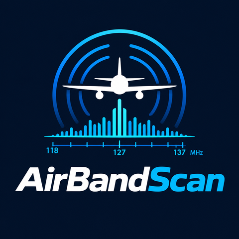
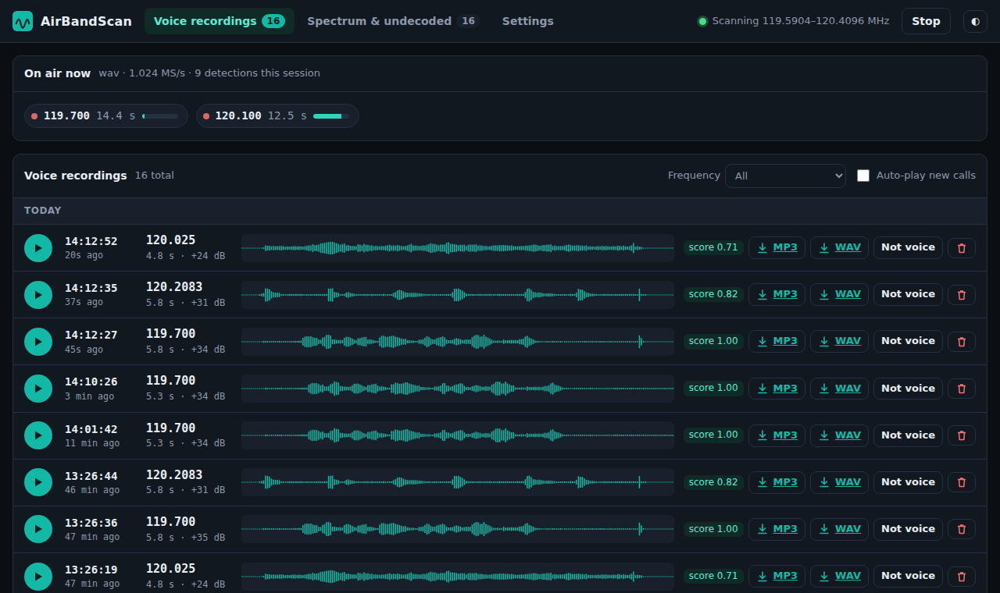
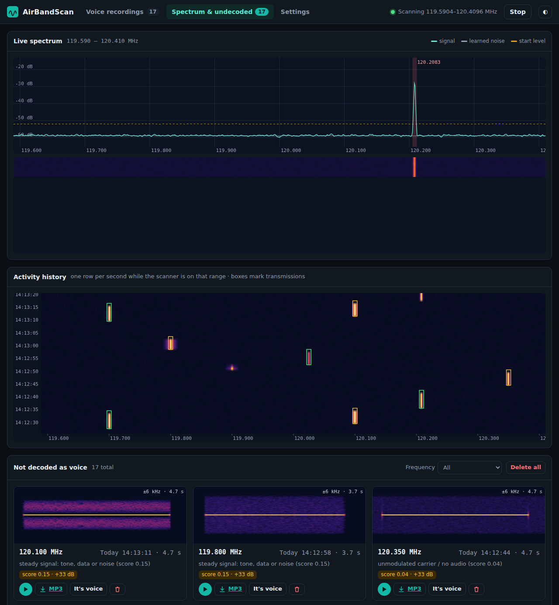
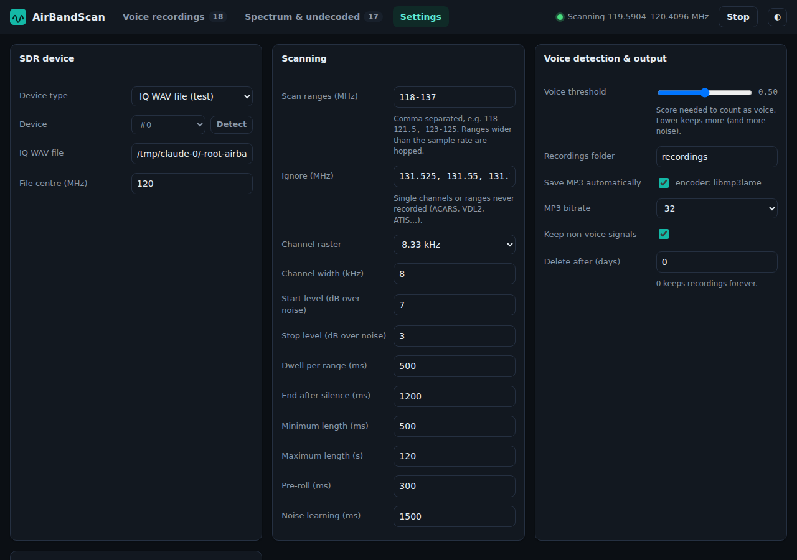

<div align="center">



### Automatic VHF airband scanner and voice recorder

Scans the aviation band with an SDR, records every voice call on its own,<br>
and lets you listen, browse and download them from a web browser.


[Features](#features) · [Screenshots](#screenshots) · [Install](#install) · [Usage](#usage) · [How it works](#how-it-works) · [API](#http-api)

</div>

---

## Features

- 📡 **Automatic scanning:** hops across your frequency ranges (118–137 MHz by default) and stays on a range while someone is talking.
- 🎙️ **Records every call:** each transmission is saved on its own, with a short pre-roll so the first word isn't cut off.
- 🗣️ **Voice detection:** a built-in speech detector separates real voice from data bursts, dead carriers, tones and noise.
- 🎧 **Play in the browser:** click a waveform to seek, or turn on auto-play for new calls.
- 💾 **MP3 and WAV:** voice calls are saved as MP3 automatically; any recording can be downloaded as MP3 or WAV.
- 🌈 **Spectrum page:** live spectrum, waterfall and activity history, plus a spectrogram of every signal that was *not* recognised as voice.
- ✈️ **Voice only:** ACARS and VDL2 data channels are ignored by default.
- ⚙️ **Web settings:** device, gain, ranges, thresholds and MP3 options, all from the browser.
- 🖥️ **Single native program:** C++17, no Python, runs as a desktop app or headless server on Windows and Linux; open it from any phone or PC on your network.

## Screenshots

<div align="center">

**Voice recordings**



**Spectrum & undecoded signals**



**Settings**



</div>

## Install

### Linux (Debian / Ubuntu)

```bash
sudo apt install build-essential cmake ninja-build pkg-config librtlsdr-dev libmp3lame0
# optional: libairspy-dev libhackrf-dev   (SDRplay: install the SDRplay API 3.x)

cmake -S . -B build -G Ninja -DCMAKE_BUILD_TYPE=Release
ninja -C build
./build/airbandscan
```

Fedora: `rtl-sdr-devel lame-libs` · Arch: `rtl-sdr lame`

### Windows (MSYS2 / MinGW-w64)

Open the **MSYS2 MINGW64** shell:

```bash
pacman -S --needed mingw-w64-x86_64-toolchain mingw-w64-x86_64-cmake mingw-w64-x86_64-ninja \
  mingw-w64-x86_64-pkgconf mingw-w64-x86_64-rtl-sdr mingw-w64-x86_64-lame
# optional: mingw-w64-x86_64-airspy mingw-w64-x86_64-hackrf

cmake -S . -B build -G Ninja
ninja -C build
./build/airbandscan.exe
```

The needed DLLs are copied next to `airbandscan.exe`, so it also starts with a double-click.
For an RTL-SDR on Windows, install the WinUSB driver with [Zadig](https://zadig.akeo.ie/).

> **MP3:** LAME is loaded at run time (`libmp3lame.so.0` / `libmp3lame-0.dll`). If it is
> missing, a `lame` or `ffmpeg` command on `PATH` is used instead. Without either, WAV still
> works and the Settings page tells you MP3 is unavailable.

## Usage

```
airbandscan [-c airband.conf] [-p 8080] [-d recordings] [--no-autostart]
```

1. Plug in your SDR and start `airbandscan`.
2. Open **http://localhost:8080/**, or `http://<computer-ip>:8080/` from a phone or tablet.
3. Under **Settings**, choose your device, set the gain (about 30–40 dB on an RTL-SDR) and enter your local frequencies.
4. Calls appear on **Voice recordings** as they happen.

On first start a commented `airband.conf` is created; see [`airband.conf.example`](airband.conf.example).

### Tips

| Tip | Why |
|---|---|
| List only the frequencies used near you, e.g. `118.1-119.0, 121.5-122.0` | One RTL-SDR sees about 1.9 MHz at a time; 118–137 MHz needs 10 hops, and calls on another range are missed while one is being recorded |
| Use a fixed gain rather than AGC | AGC makes the noise floor move |
| Too much noise saved as voice? Raise **Voice threshold** | Lower it if weak calls land on the Spectrum page |
| Don't want ATIS / VOLMET? Add them to **Ignore** | Continuous broadcasts are otherwise split every *Maximum length* seconds |

## How it works

```
 SDR ──► range hopping ──► FFT + noise learning ──► detection ──► per-call channel ──► AM demod ──► voice check
                                                                                                      │
                                       Voice recordings (WAV + MP3)  ◄── voice ───────────────────────┤
                                       Spectrum & undecoded (+ spectrogram) ◄── not voice ────────────┘
```

1. **Scan:** ranges are split into windows of 80 % of the sample rate; the scanner hops between them.
2. **Detect:** every 20 ms a Welch-averaged FFT is compared with each window's learned noise floor.
   A signal `start_level` dB above noise opens a call, snapped to the 8.33 kHz airband raster;
   it closes after `timeout_ms` below `stop_level`.
3. **Record:** each call gets its own channelizer and AM demodulator (8 kHz mono audio), seeded with a
   pre-roll so nothing is clipped, and a squelch gate removes the hiss before and after the carrier.
4. **Classify:** pitch periodicity, pitch movement, loudness variation and modulation depth decide
   *voice* or *not voice*. You can move any recording between the two lists yourself.

### Recordings on disk

```
recordings/2026-10-14/20261014-131915-832-0119700.wav    audio (8 kHz mono)
                                               ….mp3    MP3
                                               ….spg    spectrogram
                                               ….meta   time, frequency, level, verdict
```

The list is rebuilt from the `.meta` files at start-up, so recordings can be copied, moved or deleted with normal file tools.

## HTTP API

| Method | Path | Description |
|---|---|---|
| GET | `/api/status` | scanner state, live calls, counts |
| GET | `/api/spectrum` | live spectrum and noise floor |
| GET | `/api/history?w=N` | activity waterfall (binary) |
| GET | `/api/recordings?kind=voice\|other\|all&limit&offset&freq=MHz` | list recordings |
| GET | `/rec/<id>.wav` · `.mp3` · `.spg` (`?dl=1` to download) | recording files |
| POST | `/api/rec/<id>/voice?v=1\|0` · `/api/rec/<id>/delete` | relabel / delete |
| POST | `/api/recordings/delete?kind=other` | delete a whole list |
| GET / POST | `/api/config` | read / save settings |
| POST | `/api/start` · `/api/stop` | start / stop the scanner |

> ⚠️ The web interface has no login. Keep it on your home network, or set **Listen address** to `127.0.0.1`.

## Testing without an SDR

```bash
# Make a test IQ file: AM voice from speech files + data tone, carrier, noise, short burst
python3 tools/make_test_iq.py test_iq.wav speech1.wav speech2.wav
# Settings → Device type "IQ WAV file", file test_iq.wav, centre 120 MHz

# Range-hopping test with a simulated SDR
ninja -C build hop_test && ./build/hop_test
```

## Credits

AirBandScan builds on three open-source projects:

- **[AirScope](https://github.com/SarahRoseLives/AirScope)**: SDR drivers and DSP (voice path only; ACARS, VDL2 and ADS-B removed)
- **[rtl-sdr-scanner-cpp](https://github.com/shajen/rtl-sdr-scanner-cpp)**: scanning and transmission-detection logic, ported off GNU Radio
- **[sdr-monitor](https://github.com/shajen/sdr-monitor)**: the idea for the recordings and spectrogram web pages

## License

[GPLv3](LICENSE), the same as the projects it is based on.

<div align="center"><sub>Made for airband listeners ✈️</sub></div>
