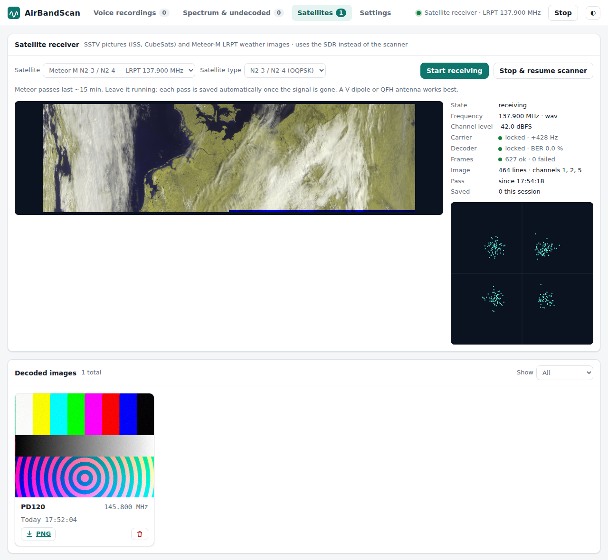

<div align="center">


### Automatic VHF airband scanner and voice recorder

Scans the aviation band with an SDR, records every voice call on its own,<br>
and lets you listen, browse and download them from a web browser.<br>
Also decodes satellite pictures: SSTV from the ISS and CubeSats, and Meteor-M LRPT weather images.


[Features](#features) · [Supported SDRs](#supported-sdrs) · [Screenshots](#screenshots) · [Install](#install) · [Usage](#usage) · [Satellites](#satellite-images-sstv-and-meteor-lrpt) · [How it works](#how-it-works) · [API](#http-api)

### Support the project

<a href="https://ko-fi.com/dhihacker" title="Support me on Ko-fi"></a>

</div>

---

## Features

- 📡 **Automatic scanning:** hops across your frequency ranges (118–137 MHz by default) and stays on a range while someone is talking.
- 🎙️ **Records every call:** each transmission is saved on its own, with a short pre-roll so the first word isn't cut off.
- 🗣️ **Voice detection:** a built-in speech detector separates real voice from data bursts, dead carriers, tones and noise.
- 🎧 **Play in the browser:** click a waveform to seek, or turn on auto-play for new calls.
- 💾 **MP3 and WAV:** voice calls are saved as MP3 automatically; any recording can be downloaded as MP3 or WAV.
- 🌈 **Spectrum page:** live spectrum, waterfall and activity history, plus a spectrogram of every signal that was *not* recognised as voice.
- ✈️ **Voice only:** ACARS and VDL2 data channels are ignored by default.
- 📻 **AM or NFM:** AM for the airband, or narrow-band FM (marine, PMR, amateur, business radio), with 8.33 / 25 / 12.5 / 6.25 / 5 kHz channel rasters.
- 🛰️ **Satellite images:** SSTV pictures from the ISS (ARISS events, PD120 / PD180) and CubeSats (Robot 36 / 72, Martin, Scottie, all PD modes), and **Meteor-M N2-3 / N2-4 LRPT** weather images (false-colour composite plus every MSU-MR channel), decoded live and kept in a gallery. Doppler is followed automatically, so no tracking software is needed.
- ⚙️ **Web settings:** device, gain, ranges, thresholds and MP3 options, all from the browser.
- 🖥️ **Single native program:** C++17, no Python, runs as a desktop app or headless server on Windows and Linux; open it from any phone or PC on your network.

## Supported SDRs

| SDR | Models | Sample rates | Build requirement |
|---|---|---|---|
| **RTL-SDR** | Any RTL2832U dongle: RTL-SDR Blog V3 / V4, Nooelec NESDR (Mini, SMArt), generic R820T / R820T2 / R828D / E4000 sticks | 1.024 – 3.2 MS/s (2.4 recommended) | `librtlsdr` (always required) |
| **RTL-SDR over the network** | Any `rtl_tcp` server: `rtl_tcp` on a Raspberry Pi / PC, SDR++ / SDR# rtl_tcp server, Android "RTL-SDR driver" | 1.024 – 3.2 MS/s (2.4 recommended; LAN bandwidth ≈ 2 bytes per sample) | none (built in) |
| **Airspy** | Airspy R2, Airspy Mini | 2.5 · 3 · 6 · 10 MS/s | `libairspy` (optional) |
| **Airspy HF+** | Airspy HF+ Dual Port, HF+ Discovery (VHF input: 60 – 260 MHz) | 192 – 912 kS/s (768 recommended) | `libairspyhf` (optional) |
| **SDRplay** | RSP1, RSP1A, RSP1B, RSP2, RSPduo, RSPdx, RSPdx R2 | 2 – 10 MS/s | SDRplay API 3.x (optional) |
| **HackRF** | HackRF One | 2 – 10 MS/s | `libhackrf` (optional) |
| **PlutoSDR** | ADALM-Pluto (Rev B/C/D), Pluto+ and other AD9361/AD9363 boards over **USB or Ethernet** | 2.4 – 10 MS/s (2.4 recommended) | `libiio` 0.x or 1.x (optional) |
| **IQ WAV file** | 8- or 16-bit stereo I/Q recordings (e.g. from SDR#, SDR++, SDRuno) | from the file | none (built in) |

- Optional drivers are detected automatically at build time; only the SDRs that were found appear under **Settings → Device type**.
- A wider sample rate covers more of the airband at once (fewer hops), but uses more CPU.
- **RTL-SDR Blog V4** needs the [rtl-sdr-blog](https://github.com/rtlsdrblog/rtl-sdr-blog) driver, a newer `librtlsdr` than most Linux distributions ship.
- **Airspy HF+** has a narrow bandwidth (under 1 MHz), so it hops through 118–137 MHz in about 30 steps. For quicker coverage, narrow the scan ranges to your local frequencies. Gain `-1` turns on AGC; 0–48 sets the attenuator (48 = none).

### RTL-SDR over the network (rtl_tcp)

Put the dongle next to the antenna and run AirBandScan on another computer.
1. On the computer with the dongle, start the server so it listens on the network:
   ```bash
   rtl_tcp -a 0.0.0.0          # Debian / Raspberry Pi OS: sudo apt install rtl-sdr
   ```
2. In AirBandScan, choose **Settings → Device type → RTL-SDR (rtl_tcp)** and enter the server as `host:port`, e.g. `192.168.1.20:1234` (port 1234 is the default). **Test** checks the connection.

Gain, ppm and bias-T are sent to the server. A 2.4 MS/s stream is about 4.8 MB/s, so wired Ethernet or good Wi-Fi is needed. rtl_tcp has no security: only use it on a trusted network.

### PlutoSDR

- **Connection:** set **Settings → Pluto address**.
  - USB: leave it empty, or use `ip:192.168.2.1`; a Pluto on USB also shows up as a network card at that address.
  - Ethernet (Pluto+, or a Pluto with a USB-Ethernet adapter): `ip:<address>`, e.g. `ip:192.168.1.50` or `ip:pluto.local`.
  - A specific USB device: `usb:1.4.5`. **Detect** lists the Plutos found by USB scan and mDNS.
- **Airband frequencies:** a stock Pluto (AD9363) only tunes 325 – 3800 MHz. Enable the AD9364 range (70 MHz – 6 GHz) once:
  ```bash
  ssh root@192.168.2.1          # password: analog
  fw_setenv attr_name compatible
  fw_setenv attr_val ad9364
  reboot
  ```
  Without this, AirBandScan reports that the Pluto rejected the frequency.
- **Gain:** `-1` = AGC (slow attack); 0 – 71 dB = manual.
- **Sample rate:** 2.4 MS/s is the safe choice over USB 2.0 and the USB network link; higher rates may drop samples.

## Screenshots

<div align="center">

**Voice recordings**


**Spectrum & undecoded signals**


**Satellites (SSTV & Meteor-M LRPT)**



**Settings**


</div>

## Install

### Download (prebuilt)

Ready-to-run packages are on the **[Releases](https://github.com/dhihacker/AirBandScan/releases)** page:

| System | File |
|---|---|
| Windows 64-bit / 32-bit | `airbandscan-*-windows-x64.zip` / `-windows-x86.zip` |
| Linux 64-bit / 32-bit | `airbandscan-*-linux-x86_64.tar.gz` / `-linux-i386.tar.gz` |
| Raspberry Pi 64-bit / 32-bit OS | `airbandscan-*-raspberrypi-arm64.tar.gz` / `-raspberrypi-armhf.tar.gz` |

Linux and Raspberry Pi builds need Debian 12, Ubuntu 24.04, Raspberry Pi OS (bookworm) or newer, plus
`sudo apt install librtlsdr0 libairspy0 libairspyhf1 libhackrf0 libiio0 libmp3lame0`. Releases are built by
[GitHub Actions](.github/workflows/release.yml) whenever a version tag such as `v1.0.0` is pushed.

### Build from source

#### Linux (Debian / Ubuntu)

```bash
sudo apt install build-essential cmake ninja-build pkg-config librtlsdr-dev libmp3lame0
# optional: libairspy-dev libairspyhf-dev libhackrf-dev libiio-dev   (SDRplay: install the SDRplay API 3.x)

cmake -S . -B build -G Ninja -DCMAKE_BUILD_TYPE=Release
ninja -C build
./build/airbandscan
```

Fedora: `rtl-sdr-devel lame-libs` · Arch: `rtl-sdr lame`

#### Windows (MSYS2)

Open the **MSYS2 UCRT64** shell:

```bash
pacman -S --needed mingw-w64-ucrt-x86_64-toolchain mingw-w64-ucrt-x86_64-cmake mingw-w64-ucrt-x86_64-ninja \
  mingw-w64-ucrt-x86_64-pkgconf mingw-w64-ucrt-x86_64-rtl-sdr mingw-w64-ucrt-x86_64-lame
# optional: mingw-w64-ucrt-x86_64-hackrf mingw-w64-ucrt-x86_64-libiio
# Airspy HF+: MSYS2 has no package; see the libairspyhf step in .github/workflows/release.yml

cmake -S . -B build -G Ninja
ninja -C build
./build/airbandscan.exe
```

32-bit Windows: MSYS2 no longer packages librtlsdr for 32-bit, so build it from
source; see the `windows-x86` job in [`.github/workflows/release.yml`](.github/workflows/release.yml).

The needed DLLs are copied next to `airbandscan.exe`, so it also starts with a double-click.
For an RTL-SDR on Windows, install the WinUSB driver with [Zadig](https://zadig.akeo.ie/).

### Docker

The image compiles AirBandScan from source with the [RTL-SDR Blog driver](https://github.com/rtlsdrblog/rtl-sdr-blog),
so RTL-SDR Blog V4 dongles work, as do the other SDRs. Nothing in it is x86-specific, so it should also build on a Raspberry Pi (64-bit or 32-bit OS).

```bash
git clone https://github.com/dhihacker/AirBandScan.git
cd AirBandScan
docker compose up -d --build
```

Open **http://\<host-ip\>:8080/**. The settings (`airband.conf`) and recordings are kept in the Docker volumes
`airbandscan_config` and `airbandscan_recordings`. USB SDRs are passed in through `/dev/bus/usb`, so a dongle can be
replugged without restarting the container; network SDRs (rtl_tcp, PlutoSDR over IP) need nothing extra.
The kernel DVB driver is detached from the dongle automatically, so nothing has to be blacklisted on the host.

> **MP3:** LAME is loaded at run time (`libmp3lame.so.0` / `libmp3lame-0.dll`). If it is
> missing, a `lame` or `ffmpeg` command on `PATH` is used instead. Without either, WAV still
> works and the Settings page tells you MP3 is unavailable.

## Usage

```
airbandscan [-c airband.conf] [-p 8080] [-d recordings] [--no-autostart]
airbandscan --decode-sstv FILE | --decode-lrpt FILE [--meteor m2x|m2] [-o DIR]
```

1. Plug in your SDR and start `airbandscan`.
2. Open **http://localhost:8080/**, or `http://<computer-ip>:8080/` from a phone or tablet.
3. Under **Settings**, choose your device, set the gain (about 30–40 dB on an RTL-SDR) and enter your local frequencies.
4. Calls appear on **Voice recordings** as they happen.

On first start a commented `airband.conf` is created; see [`airband.conf.example`](airband.conf.example).

### Tips

| Tip | Why |
|---|---|
| List only the frequencies used near you, e.g. `118.1-119.0, 121.5-122.0` | One RTL-SDR sees about 1.9 MHz at a time; 118–137 MHz needs 10 hops, and calls on another range are missed while one is being recorded |
| Use a fixed gain rather than AGC | AGC makes the noise floor move |
| Too much noise saved as voice? Raise **Voice threshold** | Lower it if weak calls land on the Spectrum page |
| Don't want ATIS / VOLMET? Add them to **Ignore** | Continuous broadcasts are otherwise split every *Maximum length* seconds |
| Scanning FM radio (marine, PMR446, amateur)? Set **Modulation** to *NFM*, **Channel width** 12.5 kHz (25 kHz channels: 16 kHz) and the matching **Channel raster**, e.g. 6.25 or 12.5 kHz | Airband voice is AM; most other VHF/UHF voice is narrow FM. All scan ranges use the same modulation |

## Satellite images (SSTV and Meteor LRPT)

Open **Satellites**, choose a satellite and press **Start receiving**. The SDR then stays on
that frequency instead of scanning the airband. **Stop & resume scanner** goes back to scanning.
The mode you used last is the one started at launch.

| Preset | Frequency | What you get |
|---|---|---|
| **ISS — SSTV** | 145.800 MHz FM | ARISS SSTV events, usually PD120 or PD180 (640 × 496) |
| **Meteor-M N2-3 / N2-4 — LRPT** | 137.900 MHz (137.100 MHz alternate) | 1568 px wide MSU-MR images: 221 false-colour composite + each channel |
| **Other** | any | SSTV from CubeSats or amateur stations (e.g. 435–438 MHz), or LRPT on another frequency |

- **Leave it running:** every SSTV picture is found by its VIS header and saved on its own. A Meteor pass is saved when its signal has been gone for 90 s. Pictures appear in **Decoded images** and update live while they arrive.
- **No tracking needed:** Doppler (±3.5 kHz) and dongle frequency error (up to ±20 kHz for LRPT) are followed automatically.
- **SSTV modes:** PD50, PD90, PD120, PD160, PD180, PD240, PD290, Robot 36, Robot 72, Martin M1 / M2, Scottie S1 / S2 / DX. Slant from the transmitter's clock error is corrected from the sync pulses.
- **Meteor LRPT:** 72 ksym/s OQPSK with NRZ-M (N2-3 and N2-4); choose *N2 (QPSK)* for recordings of the retired Meteor-M N2. The 80k interleaved test mode is not supported.
- **Antenna:** a V-dipole or QFH tuned for 137 MHz for Meteor; a vertical or small Yagi for the ISS. LRPT needs a clear sky view; SSTV from the ISS works with a simple antenna.
- **SDR:** any of the supported SDRs. An RTL-SDR runs at 1.024 MS/s in satellite mode to save CPU; other SDRs use the sample rate from Settings. PlutoSDR needs the AD9364 range for 137 / 145 MHz.
- **Orientation:** on northbound passes the Meteor image is upside down (north at the bottom). That is how the satellite scans.

Find pass times with any satellite tracker (Heavens-Above, Gpredict, the ARISS SSTV event page).

### Decode a recording from the command line

```bash
# SSTV from receiver audio (any WAV: from a radio, SDR# / SDR++ audio recording, …)
airbandscan --decode-sstv iss_pass.wav -o pictures

# Meteor LRPT from an IQ recording centred on the signal (≥ 144 kS/s), 8-bit soft symbols (.s) or CADUs (.cadu)
airbandscan --decode-lrpt meteor_baseband.wav -o pictures
airbandscan --decode-lrpt old_meteor_m2.wav --meteor m2 -o pictures   # retired Meteor-M N2 (QPSK)
```

## How it works

```
 SDR ──► range hopping ──► FFT + noise learning ──► detection ──► per-call channel ──► AM / NFM demod ──► voice check
                                                                                                      │
                                       Voice recordings (WAV + MP3)  ◄── voice ───────────────────────┤
                                       Spectrum & undecoded (+ spectrogram) ◄── not voice ────────────┘
```

Satellites (one SDR, instead of the scanner):

```
 SDR ──► channel ──► FM demod ──► 1900 Hz FM-to-frequency ──► VIS header ──► sync-locked lines ──► SSTV picture
     └─► channel ──► (O)QPSK demod (x⁴ FFT acquisition, Costas, Gardner) ──► Viterbi r=½ K=7 ──► NRZ-M
         ──► 1ACFFC1D frame sync ──► derandomise ──► Reed-Solomon (255,223)×4 ──► CCSDS packets ──► MSU-MR JPEG ──► image
```

1. **Scan:** ranges are split into windows of 80 % of the sample rate; the scanner hops between them.
2. **Detect:** every 20 ms a Welch-averaged FFT is compared with each window's learned noise floor.
   A signal `start_level` dB above noise opens a call, snapped to the 8.33 kHz airband raster;
   it closes after `timeout_ms` below `stop_level`.
3. **Record:** each call gets its own channelizer and AM or NFM demodulator (8 kHz mono audio), seeded with a
   pre-roll so nothing is clipped, and a squelch gate removes the hiss before and after the carrier.
4. **Classify:** pitch periodicity, pitch movement, loudness variation and modulation depth decide
   *voice* or *not voice*. You can move any recording between the two lists yourself.

### Recordings on disk

```
recordings/2026-10-14/20261014-131915-832-0119700.wav    audio (8 kHz mono)
                                               ….mp3    MP3
                                               ….spg    spectrogram
                                               ….meta   time, frequency, level, verdict
```

The list is rebuilt from the `.meta` files at start-up, so recordings can be copied, moved or deleted with normal file tools.

Satellite images go to `recordings/images/YYYY-MM-DD/`: `<id>.png` (picture or LRPT composite), `<id>_thumb.png`,
`<id>_ch1.png` … (LRPT channels) and `<id>.imeta`.

## HTTP API

| Method | Path | Description |
|---|---|---|
| GET | `/api/status` | scanner state, live calls, counts |
| GET | `/api/spectrum` | live spectrum and noise floor |
| GET | `/api/history?w=N` | activity waterfall (binary) |
| GET | `/api/recordings?kind=voice\|other\|all&limit&offset&freq=MHz` | list recordings |
| GET | `/rec/<id>.wav` · `.mp3` · `.spg` (`?dl=1` to download) | recording files |
| POST | `/api/rec/<id>/voice?v=1\|0` · `/api/rec/<id>/delete` | relabel / delete |
| POST | `/api/recordings/delete?kind=other` | delete a whole list |
| GET / POST | `/api/config` | read / save settings |
| POST | `/api/start` · `/api/stop` | start / stop (the scanner, or the satellite receiver in satellite mode) |
| POST | `/api/sat/start` (`sat_mode=sstv\|lrpt`, `sat_freq_mhz`, `sat_lrpt_variant=m2x\|m2`) · `/api/sat/stop` | satellite receiver on / back to the scanner |
| GET | `/api/sat/status` · `/api/sat/live.png` | receiver state, lock, constellation · picture in progress |
| GET | `/api/images?kind=sstv\|lrpt&limit&offset` · `/img/<id>.png` (`_thumb`, `_chN`) | decoded images |
| POST | `/api/img/<id>/delete` | delete an image |

> ⚠️ The web interface has no login. Keep it on your home network, or set **Listen address** to `127.0.0.1`.

## Testing without an SDR

```bash
# Make a test IQ file (add --fm for narrow-band FM): voice from speech files + data tone, carrier, noise, short burst
python3 tools/make_test_iq.py test_iq.wav speech1.wav speech2.wav
# Settings → Device type "IQ WAV file", file test_iq.wav, centre 120 MHz

# Range-hopping test with a simulated SDR
ninja -C build hop_test && ./build/hop_test

# SSTV: a test picture in any mode, as audio, or FM-modulated IQ with Doppler and noise
python3 tools/make_test_sstv.py PD120 sstv.wav && ./build/airbandscan --decode-sstv sstv.wav
python3 tools/make_test_sstv.py PD180 iss_iq.wav --iq --rate 250000 --offset 40000
# → device "IQ WAV file", centre 145.76 MHz; Satellites → ISS

# Meteor LRPT: re-modulate decoded CADUs (e.g. a SatDump .cadu) as OQPSK with Doppler and noise
python3 tools/make_test_lrpt.py pass.cadu lrpt_iq.wav --snr 6 && ./build/airbandscan --decode-lrpt lrpt_iq.wav
```

## Credits

AirBandScan builds on three open-source projects:

- **[AirScope](https://github.com/SarahRoseLives/AirScope)**: SDR drivers and DSP (voice path only; ACARS, VDL2 and ADS-B removed)
- **[rtl-sdr-scanner-cpp](https://github.com/shajen/rtl-sdr-scanner-cpp)**: scanning and transmission-detection logic, ported off GNU Radio
- **[sdr-monitor](https://github.com/shajen/sdr-monitor)**: the idea for the recordings and spectrogram web pages

The SSTV and LRPT decoders are written for AirBandScan. The Meteor link parameters and MSU-MR image format follow
[SatDump](https://github.com/SatDump/SatDump) and [meteor_decoder](https://github.com/artlav/meteor_decoder).
PNG output uses [stb_image_write](https://github.com/nothings/stb) (public domain).
Docker support was contributed by [Ameer Dawood](https://github.com/ameer1234567890).

## License

[GPLv3](LICENSE), the same as the projects it is based on.


